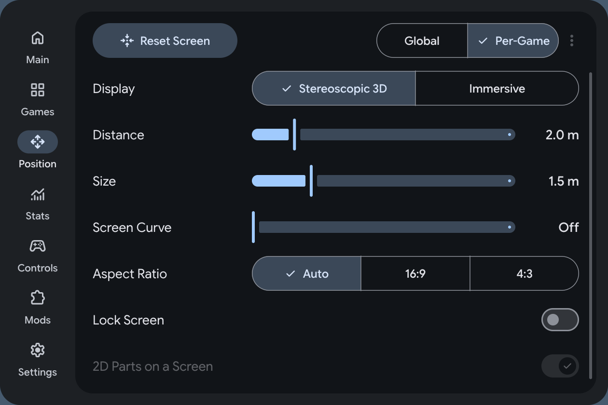
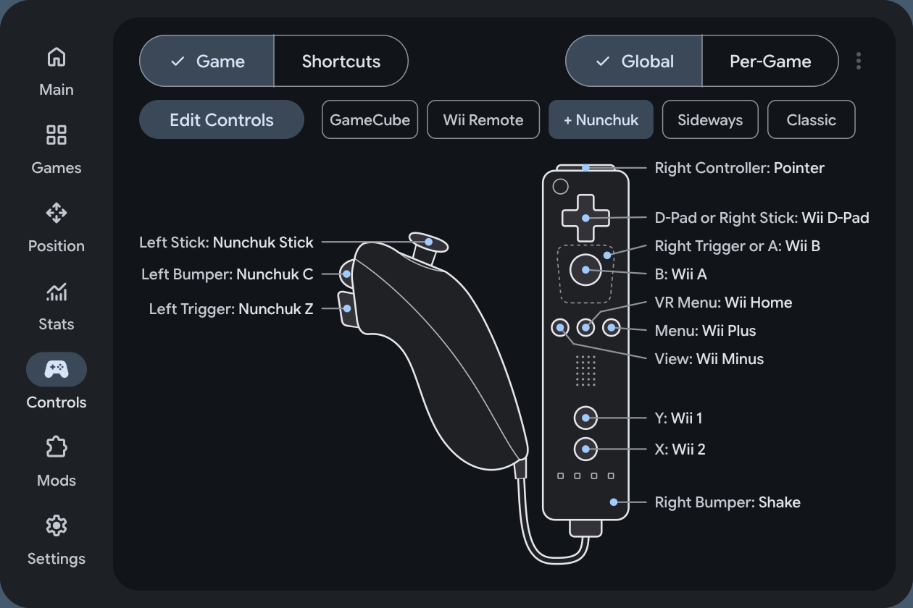
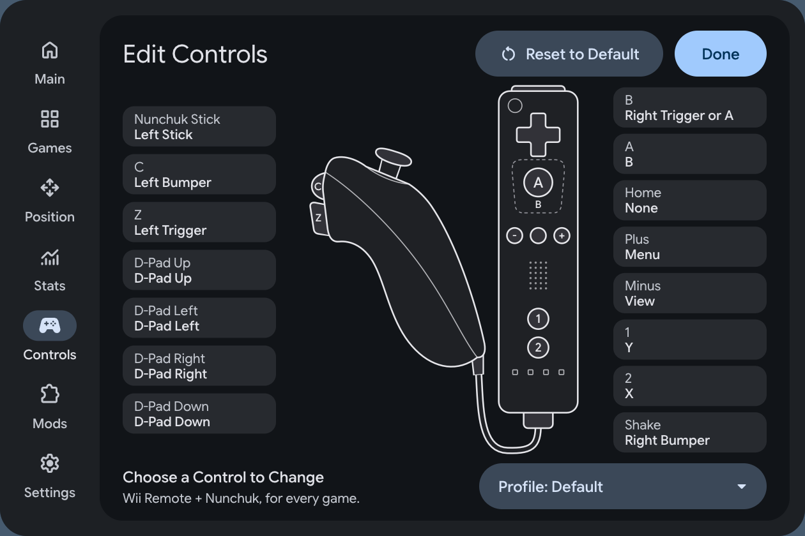
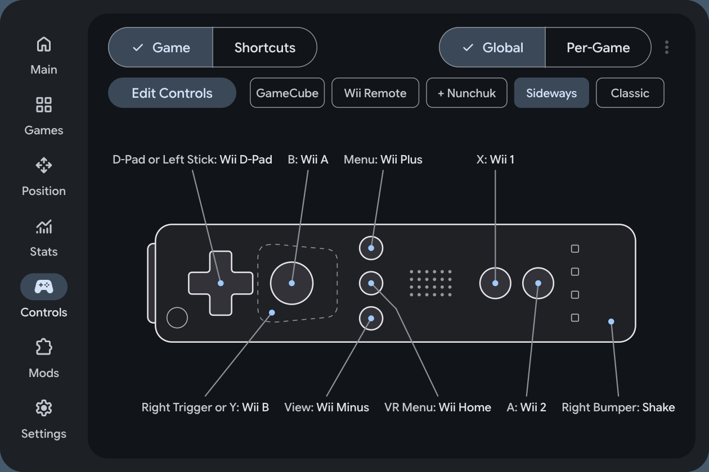

# Baiji VR

GameCube and Wii games in VR, running standalone on the Valve Steam Frame.
It is my unofficial fork of [Baiji](https://github.com/thejerf/baijiSteamVR) by thejerf, the Steam Frame version of iChris4's [dolphinXR](https://github.com/iChris4/dolphinXR/), which is based on [Dolphin](https://dolphin-emu.org/).


## Features

- Stereoscopic 3D or Immersive, and Flat, switched mid-game
- Natural 3D, matched to your IPD, and a curved screen
- A redesigned VR menu with save states and autosave
- A Games tab: start another game without leaving VR
- In-app mod, cheat and texture pack downloader
- Edit the controls on drawings of the GameCube and Wii controllers
- Game-specific fixes

## Built on Baiji

[Baiji](https://github.com/thejerf/baijiSteamVR) got all of this started. thejerf made dolphinXR a native Steam Frame app, with 3D that works out of the box, the Frame's controllers and smooth frames in the headset. Thank you! I plan to bring my fixes back to it.

## 3D and immersion

- **Stereoscopic 3D or Immersive, any time**: press both bumpers, then **View** and **Menu**.
- **Stereoscopic 3D**: the game in 3D on a screen you can grab, move and resize.
- **Immersive**: you are inside the game, drawn two steps over **Internal Resolution**.
- **Natural 3D**: at 100% **3D Depth**, distant scenery sits at infinity, from your IPD as the Frame measures it.
- **Screen Curve**: bends the screen around you, up to 90°.
- **World Scale**: how big the game world feels.
- **Switch to Flat**: the same game goes on in the window, and back.

## The VR menu

Hold **Menu** for 1 second to open the completely redesigned VR menu. It supports global and per-game settings.

 

- **Main**: save states with pictures, screenshots, Fast Forward, **Switch to Flat**
- **Games**: your games with covers, search, sorting and favourites
- **Position**: the screen's distance, size, curve and shape
- **Stats**: frame rate, resolution and headset numbers, in front of you or on your wrist
- **Controls**, **Mods** and **Settings**: below, and the window's own settings

 

## Controllers

Every controller is drawn with the Frame button for each control.

 

- **Wii games** play with a **GameCube** controller, **Wii Remote**, **+ Nunchuk**, **Sideways** or **Classic**.
- **Edit Controls**: choose a control on the drawing, then press the button for it.
- **Global** or **Per-Game** mappings, and saved profiles
- **Well-known games start with the right controller**: Kirby's Return to Dream Land and New Super Mario Bros. Wii with the Wii Remote on its side, Super Mario Galaxy with the Nunchuk.

 

## Mods, cheats and textures

- **Mods and Cheats**: 37 cheats, patches and game settings, and 3 mods, for 23 games
- **Textures**: 24 texture packs, from their creators' own pages

 

No texture pack is hosted by this project.

## Game-specific fixes

- **Fire Emblem: Path of Radiance** (USA): no more freeze and white screen, confirmed on the Frame
- **Fixes to switch on under Mods**: Eternal Darkness, F-Zero GX, Luigi's Mansion, Metroid Prime, Star Fox Adventures, The Last Story, The Legend of Zelda: Skyward Sword and Wii Sports Resort
- **16:9 widescreen** in 12 games, such as The Wind Waker, Double Dash!!, Super Smash Bros. Melee and Pikmin 2
- **60 FPS** in Super Mario Sunshine and Pikmin 2

## Other fixes

- **Save states**: no freeze while saving; both eyes come back right in VR
- **Games that change video modes**: the screen keeps one shape
- **Immersive**: drawing errors
- **Wii Remote**: Shake works in VR
- No crash on exit; errors show in the headset

## The window in Game Mode

It fits the screen, works with the controller and sits in SteamVR's theater between VR games. **Window Scale** sets its size.

## Experimental

Off by default: **Dynamic Resolution**, **Pin Emulation Threads**, **Performance Hint** and [more](docs/SETTINGS.md#performance), with a [performance test](docs/USER_GUIDE.md#performance-test).

## Requirements

- A Steam Frame with Developer Mode, SSH and 250 MB free
- A Linux PC (x86-64) with Git, Podman and Flatpak
- Your own GameCube and Wii games

## Install

There is no download yet. New work is tested on a desktop; testing on the Frame is in progress.

1. Set up the [SSH name `frame`](docs/USER_GUIDE.md#connect-to-the-frame) on your PC.

2. Get the repository, build it and install it:

   ```sh
   git clone --recurse-submodules https://github.com/simplysanatori/BaijiVR.git
   cd BaijiVR
   ./scripts/compile-cross-sdk.sh
   ./scripts/deploy-frame.sh frame
   ```

3. Add it to Steam:

   ```sh
   ssh frame "steamos-add-to-steam ./baiji/bin/baiji-vr"
   ```

4. Launch **baiji-vr** from your Steam library.

## First run

1. Add your games' folder in the settings, under **Paths**.
2. Choose **Download** when it asks **Download Thumbnails?** if you want covers.
3. Double-click a game.

## Controls

| Steam Frame | What it does |
|---|---|
| **A**, **B**, **X**, **Y** | The game's buttons, by position |
| Hold **Menu** for 1 second | VR menu |
| Hold **View** for 1.5 seconds | Stop the game |
| **View**, then right or left bumper | Quick Save or Quick Load (hold the left bumper) |
| **View**, then right trigger | Fast Forward on or off |
| Both bumpers, then **View** and **Menu** | Stereoscopic 3D or Immersive |
| Grip | Move the screen |
| Grip and D-Pad up or down | **Screen Curve** |

Full list: [docs/CONTROLS.md](docs/CONTROLS.md).

## Update

Quit the emulator. In the `BaijiVR` folder:

```sh
git pull
git submodule update --init --recursive
./scripts/compile-cross-sdk.sh
./scripts/deploy-frame.sh frame
```

## Uninstall

On the Frame. `--purge` also deletes your settings and saves. [More](docs/USER_GUIDE.md#uninstall).

```sh
~/baiji/bin/baiji-uninstall
```

## Troubleshooting

- The pointer is off in Stereoscopic 3D: recenter once.
- A game looks wrong in Immersive: switch to Stereoscopic 3D.
- Immersive is slow: turn on **Dynamic Resolution**.

More: [docs/USER_GUIDE.md](docs/USER_GUIDE.md#troubleshooting).

## Reporting a problem

Turn on the detailed log, then play until the problem happens:

```sh
ssh frame "touch ~/.config/baiji/debug-logging"
```

Logs: `~/.local/share/baiji/Logs`. Check them before sharing. Don't report this fork's problems to Dolphin or Baiji.

## Roadmap (planned)

- **PC VR**: Linux desktop and Windows builds
- **Edit Controls** for gamepads and the mouse

## More

- [User guide](docs/USER_GUIDE.md)
- [Settings](docs/SETTINGS.md)
- [AGENTS.md](AGENTS.md): for developers and AI agents
- [Building from source](docs/build-runbook.md)
- [Changelog](docs/CHANGELOG.md)
- [Baiji's README](README.upstream.md)

## Support

If you want to support this app or my other Steam Frame ports, such as PrimedFrame, you can [buy me a coffee](https://ko-fi.com/sana748653).

## Credits

- [Baiji](https://github.com/thejerf/baijiSteamVR) by thejerf: the native Steam Frame version this is built on
- [dolphinXR](https://github.com/iChris4/dolphinXR/) by iChris4: the VR modes, and some performance switches
- [Dolphin](https://dolphin-emu.org/): the emulator
- [Azahar VR](https://github.com/simplysanatori/AzaharVR), my Azahar fork: the VR menu, Dynamic Resolution, the window in Game Mode and downloads
- [libretro-thumbnails](https://github.com/libretro-thumbnails): the covers
- [GameTDB](https://www.gametdb.com/): game names
- Mods, cheats and texture packs: their authors, named in the app
- Valve: SteamVR and the Frame

Full list: [Externals/licenses.md](Externals/licenses.md). Not affiliated with Nintendo, Valve or the Dolphin project.

## Licence

GPLv3 or any later version. Dolphin's own files are GPLv2 or later. See [COPYING](COPYING) and [LICENSES](LICENSES).

## How this was made

I started this project and used AI (Claude) to speed up development. I write, review and fix code by hand all the way through, keep the AI's work checked and reined in, and aim to keep the port as lightweight as possible. I test it on my own Steam Frame.
