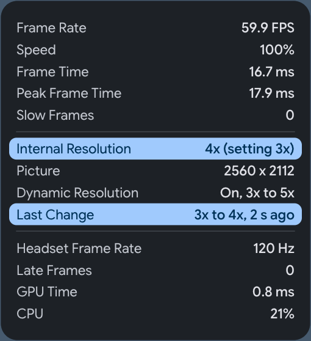
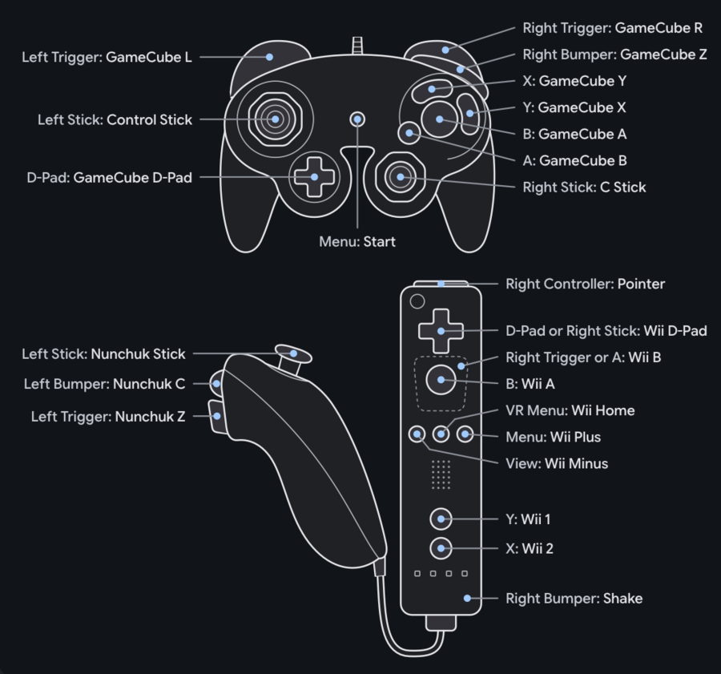

# Baiji VR

GameCube and Wii games in VR, running standalone on the Valve Steam Frame.
It is my unofficial fork of [Baiji](https://github.com/thejerf/baijiSteamVR), the Steam Frame version of [dolphinXR](https://github.com/iChris4/dolphinXR/), which is based on [Dolphin](https://dolphin-emu.org/).


This is my testing area for fixes and optimizations, and I plan to bring all of them upstream. New work is desktop-tested; testing on the Frame is in progress.

## Features

- Stereoscopic 3D, Immersive or Flat, switched mid-game
- A new VR menu: save states, stats, settings and **Edit Controls**
- Natural 3D for your IPD, and a curved screen
- Mods, patches, cheats and texture packs in the app
- A window that works with the controller in Game Mode

## 3D and immersion

- **Stereoscopic 3D or Immersive**: press both bumpers, then **View** and **Menu**.
- **Switch to Flat**: the game goes on in the window.
- **Natural 3D**: at 100% **3D Depth**, distant scenery sits at infinity.
- **World Scale**: how big the game world feels.
- **Screen Curve**: hold a grip, press the D-Pad up or down.
- **Immersive** draws two steps over **Internal Resolution**.

## The VR menu

Hold **Menu** for 1 second.

- **Main**: save states, screenshot, Fast Forward, **Switch to Flat**
- **Position**: the screen's distance, size and curve
- **Stats**: frame rate and resolution in use, in front or on your wrist
- **Controls**: the game's buttons, and **Edit Controls**
- **Mods**: mods, cheats and textures
- **Settings**: the window's settings, **Global** or **Per-Game**

  

## Controllers

- Wii games: **GameCube**, **Wii Remote**, **+ Nunchuk**, **Sideways** or **Classic**
- Mappings for every game or one game, and the window's saved profiles
- Face buttons by position

## Mods, cheats and textures

- **Mods and Cheats**: 37 cheats, patches and game settings, and 3 mods, for 23 games
- **Textures**: 24 texture packs, from their creators' own pages


No texture pack is hosted by this project.

## The window in Game Mode

- **Window Scale**, and windows that fit the screen
- Left stick moves, **A** twice starts a game, **B** goes back
- In SteamVR's theater between VR games

## Fixes

- **Fire Emblem: Path of Radiance**: the freeze and white screen, confirmed on the Frame
- **Save states in VR**: both eyes come back right
- **Games that change video modes**: the screen keeps one shape
- **Immersive**: drawing errors
- **Wii Remote**: Shake works in VR
- No crash on exit; errors show in the headset
- Mod and texture downloads work on the Frame

## Experimental

Off by default: **Dynamic Resolution**, **Pin Emulation Threads**, **Performance Hint** and [more](docs/SETTINGS.md#performance), with a [performance test](docs/USER_GUIDE.md#performance-test).

## Requirements

- A Steam Frame with Developer Mode, SSH and 250 MB free
- A Linux PC (x86-64) with Git, Podman and Flatpak
- Your own GameCube and Wii games

## Install

This fork has no download yet; [upstream Baiji](https://github.com/thejerf/baijiSteamVR/releases) has one.

1. Set up the [SSH name `frame`](docs/USER_GUIDE.md#connect-to-the-frame) on your PC.

2. Get the repository, build it and install it:

   ```sh
   git clone --recurse-submodules https://github.com/simplysanatori/baijiSteamVR.git
   cd baijiSteamVR
   ./scripts/compile-cross-sdk.sh
   ./scripts/deploy-frame.sh frame
   ```

3. Add it to Steam:

   ```sh
   ssh frame "steamos-add-to-steam ./baiji/bin/baiji-vr"
   ```

4. Launch **baiji-vr** from your Steam library.

## First run

Add your games' folder in the settings, under **Paths**, then double-click a game.

## Controls



| Steam Frame | What it does |
|---|---|
| Hold **Menu** for 1 second | VR menu |
| Hold **View** for 1.5 seconds | Stop the game |
| **View**, then right or left bumper | Quick Save or Quick Load (hold the left bumper) |
| **View**, then right trigger | Fast Forward on or off |
| Both bumpers, then **View** and **Menu** | Stereoscopic 3D or Immersive |
| Grip | Move the screen |

Full list: [docs/CONTROLS.md](docs/CONTROLS.md).

## Update

Quit the emulator. In the `baijiSteamVR` folder:

```sh
git pull
git submodule update --init --recursive
./scripts/compile-cross-sdk.sh
./scripts/deploy-frame.sh frame
```

## Uninstall

On the Frame. `--purge` also deletes your settings and saves. [More](docs/USER_GUIDE.md#uninstall).

```sh
~/baiji/bin/baiji-uninstall
```

## Troubleshooting

- The pointer is off in Stereoscopic 3D: recenter once.
- A game looks wrong in Immersive: switch to Stereoscopic 3D.
- Immersive is slow: turn on **Dynamic Resolution**.

More: [docs/USER_GUIDE.md](docs/USER_GUIDE.md#troubleshooting).

## Reporting a problem

Turn on the detailed log, then play until the problem happens:

```sh
ssh frame "touch ~/.config/baiji/debug-logging"
```

Logs: `~/.local/share/baiji/Logs`. Check them before sharing. Don't report this fork's problems to Dolphin or Baiji.

## More

- [User guide](docs/USER_GUIDE.md)
- [AGENTS.md](AGENTS.md): for developers and AI agents
- [Building from source](docs/build-runbook.md)
- [Changelog](docs/CHANGELOG.md)
- [Baiji's README](README.upstream.md)

## Support

If you want to support this app or my other Steam Frame ports, such as PrimedFrame, you can [buy me a coffee](https://ko-fi.com/sana748653).

## Credits

- [Dolphin](https://dolphin-emu.org/): the emulator
- [dolphinXR](https://github.com/iChris4/dolphinXR/) by iChris4: the VR modes, and some performance switches
- [Baiji](https://github.com/thejerf/baijiSteamVR) by thejerf: the Steam Frame version
- [Azahar for Frame](https://github.com/simplysanatori/AzaharVR), my Azahar fork: the VR menu, Dynamic Resolution, the window in Game Mode and downloads
- [GameTDB](https://www.gametdb.com/): game names
- Mods, cheats and texture packs: their authors, named in the app
- Valve: SteamVR and the Frame

Full list: [Externals/licenses.md](Externals/licenses.md). Not affiliated with Nintendo, Valve or the Dolphin project.

## Licence

GPLv3 or any later version. Dolphin's own files are GPLv2 or later. See [COPYING](COPYING) and [LICENSES](LICENSES).

## How this was made

I started this project and used AI (Claude) to speed up development. I write, review and fix code by hand all the way through, keep the AI's work checked and reined in, and aim to keep the port as lightweight as possible. I test it on my own Steam Frame.
