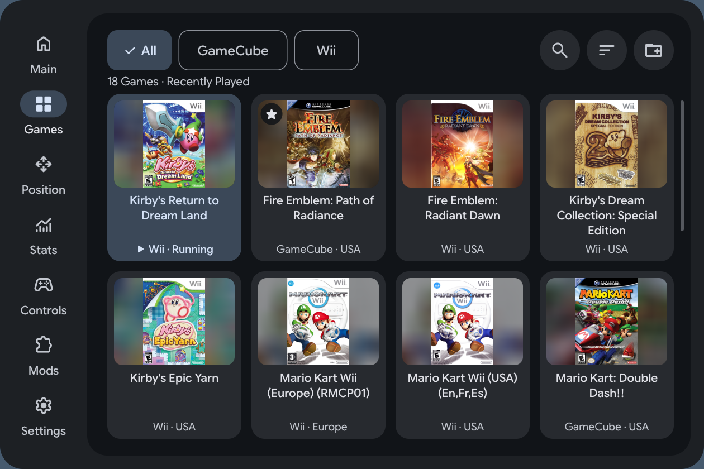
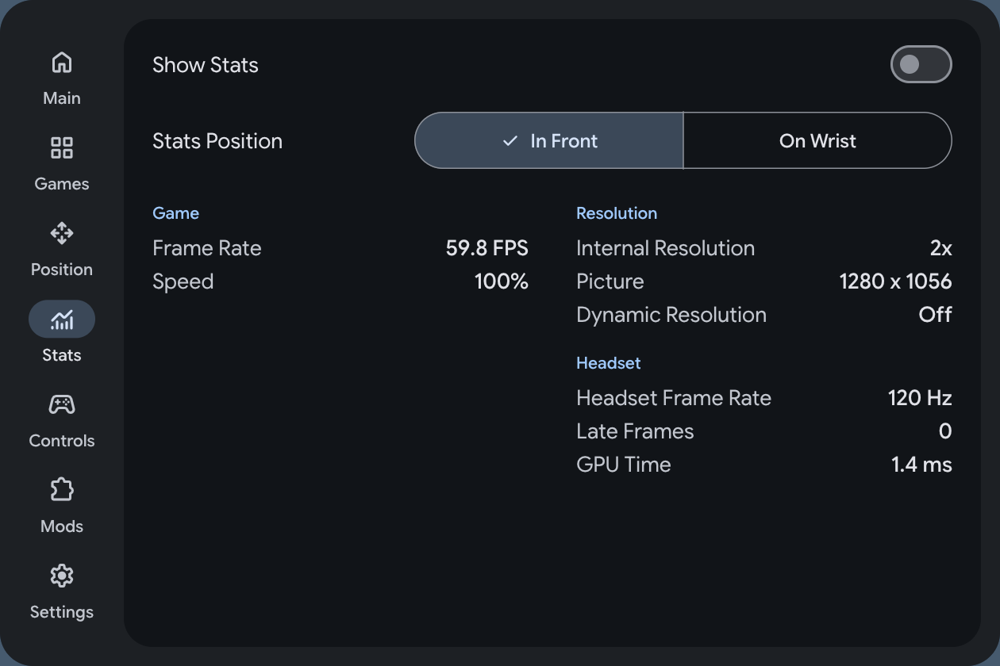
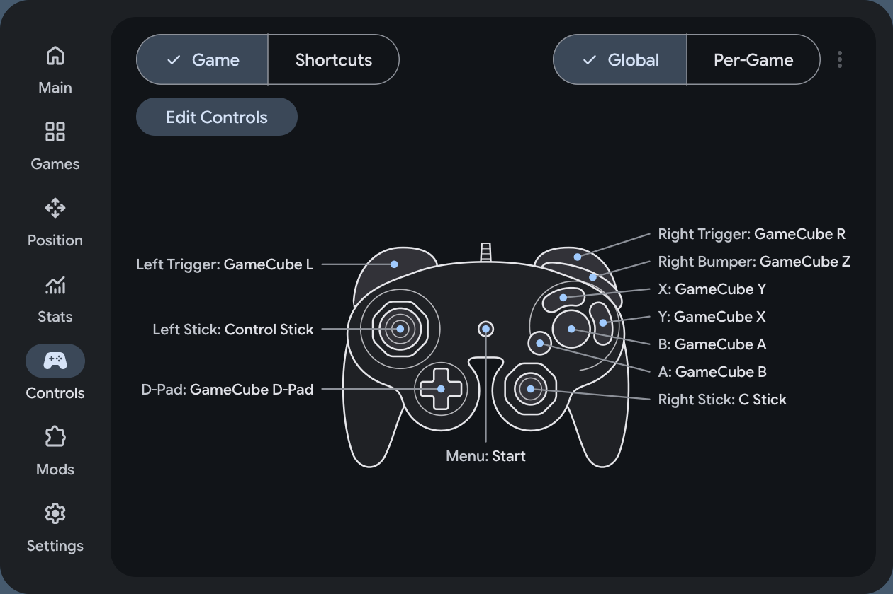
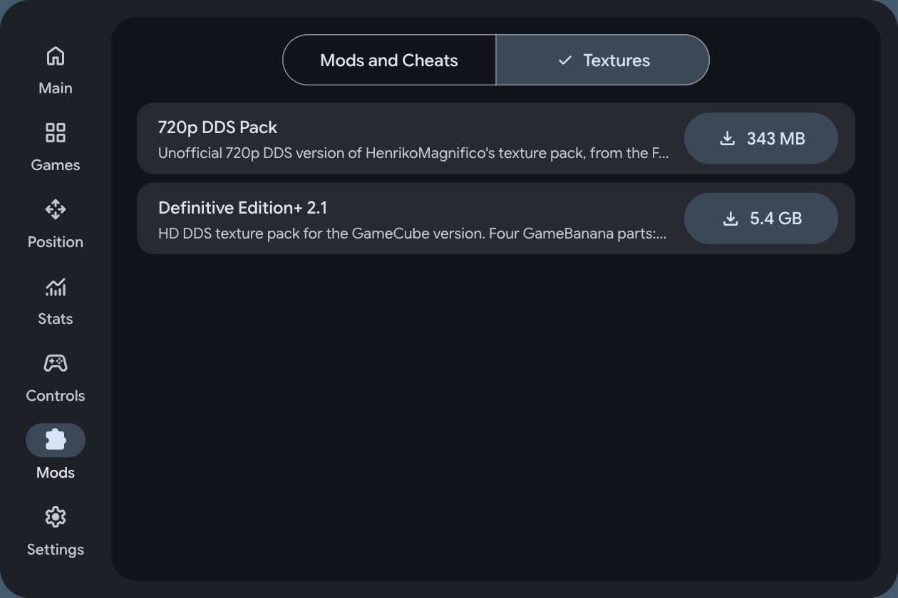

# Baiji VR

GameCube and Wii games in VR, running standalone on the Valve Steam Frame (PC VR to come).
From the developer of Azahar VR. See also [Azahar VR](https://github.com/simplysanatori/AzaharVR) for 3DS, DS and GBA games.

It is my unofficial fork of [Baiji](https://github.com/thejerf/baijiSteamVR) by thejerf, the Steam Frame version of iChris4's [dolphinXR](https://github.com/iChris4/dolphinXR/), which is based on [Dolphin](https://dolphin-emu.org/).


## Features

- Stereoscopic 3D and Immersive 3D
- Natural 3D, matched to your IPD
- Live switching between VR and Flat
- Custom VR menu with global and per-game settings
- Custom controls for every GameCube and Wii controller
- In-app mods, cheats and texture packs
- Game-specific fixes

## Built on Baiji

[Baiji](https://github.com/thejerf/baijiSteamVR) got all of this started. thejerf made dolphinXR a native Steam Frame app, with the 3D, the Frame's controllers and the smooth frames this is built on. Thank you! I plan to bring my fixes back to it.

## 3D modes

- **Stereoscopic 3D**: the game's world is rendered once for each eye, and each eye sees its own image on a virtual screen.
- **Immersive 3D**: the world is rendered at the headset's wide field of view, with 3DoF or 6DoF head tracking, two steps over **Internal Resolution**.
- **Natural 3D**: the gap between the two images is set from your IPD, the distance between your eyes. Too wide strains your eyes, too narrow looks flat. Matched, far scenery looks as far away as in real life.
- **Screen Curve** and adjustable **World Scale**
- **VR to Flat, live**: move a running game to a flat window in SteamVR and back to VR, right where you left off.

## Custom VR menu

A completely redesigned VR menu (following Material Design). Supports global and per-game settings.

 

- **Main**: save states, autosaves, screenshots and Fast Forward
- **Games**: your games list, with search, sorting and favourites
- **Position**: screen distance, size, curve and aspect ratio
- **Stats**: frame rate, game speed, internal resolution, Dynamic Resolution, late frames and GPU time
- **Controls**: custom controls for each controller, and the profiles to switch between
- **Mods**: mods, cheats and texture packs from public repositories, many downloadable in the app
- **Settings**

 

## Controller menu

Every GameCube and Wii controller is drawn with its defaults for the Steam Frame controllers.

 

- **Wii games**: GameCube Controller, Wii Remote, Wii Remote + Nunchuk, Wii Remote (Sideways) or Classic Controller
- **Edit Controls**, with global and per-game mappings and saved profiles
- **Well-known games start with the right controller**: Kirby's Return to Dream Land and New Super Mario Bros. Wii with the Wii Remote (Sideways), Super Mario Galaxy with the Nunchuk

 

## Mods, cheats and textures menu

- **Mods and cheats**: 40 for 23 games
- **Textures**: 24 texture packs from their original source, 10 of them downloadable in the app

 

No texture pack is hosted by this project.

## Game-specific fixes

- **Fire Emblem: Path of Radiance** (USA): other Dolphin VR versions freeze or show a white screen. Both are fixed here.
- **Fixes to switch on under Mods**: Eternal Darkness, F-Zero GX, Luigi's Mansion, Metroid Prime, Star Fox Adventures, The Last Story, The Legend of Zelda: Skyward Sword and Wii Sports Resort
- **16:9 widescreen** in 12 games, such as The Wind Waker, Double Dash!!, Super Smash Bros. Melee and Pikmin 2
- **60 FPS** in Super Mario Sunshine and Pikmin 2

## Other fixes

- **Save states**: no freeze while saving; both eyes come back right in VR
- **Immersive 3D**: drawing errors
- **Wii Remote**: Shake works in VR
- The screen keeps one shape when a game changes video modes
- No crash on exit; errors show in the headset

## Experimental

Off by default: **Dynamic Resolution**, **Pin Emulation Threads**, **Performance Hint** and [more](docs/SETTINGS.md#performance), with a [performance test](docs/USER_GUIDE.md#performance-test).

## Requirements

- A Steam Frame with 250 MB free
- Your own GameCube and Wii games

## Install

- [Frametanium](https://github.com/Cogential/frametanium): add `simplysanatori/BaijiVR`.
- [FrameDrop](https://framedropvr.com): [Install with FrameDrop](https://framedropvr.com/install?manifest=https%3A%2F%2Fgithub.com%2Fsimplysanatori%2FBaijiVR%2Freleases%2Flatest%2Fdownload%2Fbaijivr.framedrop.json).
- By hand: download `baijivr-<version>-linux-arm64.tar.gz` from [Releases](https://github.com/simplysanatori/BaijiVR/releases). In Konsole on the Frame:

  ```sh
  mkdir -p ~/Downloads/baijivr
  tar -xzf ~/Downloads/baijivr-<version>-linux-arm64.tar.gz -C ~/Downloads/baijivr
  bash ~/Downloads/baijivr/install.sh
  ```

Building it yourself: [user guide](docs/USER_GUIDE.md#build-and-install-from-a-pc).

## First run

1. Add your games' folder in the settings, under **Paths**.
2. Choose **Download** when it asks **Download Thumbnails?** if you want covers and banners.
3. Double-click a game.

## Controls

| Steam Frame | What it does |
|---|---|
| **A**, **B**, **X**, **Y** | The game's buttons, by position |
| Hold **Menu** for 1 second | VR menu |
| Hold **View** for 1.5 seconds | Stop the game |
| **View**, then right or left bumper | Quick Save or Quick Load (hold the left bumper) |
| **View**, then right trigger | Fast Forward on or off |
| Hold **L3** for 1 second | Stereoscopic 3D or Immersive |
| Hold **R3** for 1 second | Reset the screen or view |
| Grip | Move the screen |
| Grip and D-Pad up or down | **Screen Curve** |

The ones with **View** work in Flat, too. Full list: [docs/CONTROLS.md](docs/CONTROLS.md).

## Update

Quit the emulator, then install the new version the same way.

## Uninstall

In Konsole on the Frame. `--purge` also deletes your settings and saves. [More](docs/USER_GUIDE.md#uninstall).

```sh
~/baiji/bin/baiji-uninstall
```

## Troubleshooting

- The pointer is off in Stereoscopic 3D: recenter once.
- A game looks wrong in Immersive: switch to Stereoscopic 3D.
- Immersive is slow: turn on **Dynamic Resolution**.

More: [docs/USER_GUIDE.md](docs/USER_GUIDE.md#troubleshooting).

## Reporting a problem

1. Choose **Help** > **Report a Problem** > **Save Report** in the window, or **Settings** > **General** > **Report a Problem** in the VR menu. A zip is saved in Downloads.
2. Attach the zip to an [issue](https://github.com/simplysanatori/BaijiVR/issues).

**See What's Sent** shows all of it. Nothing is sent unless you press **Send Report**.

For a more detailed log, run `touch ~/.config/baiji/debug-logging` in Konsole on the Frame and play until the problem happens. Don't report this fork's problems to Dolphin or Baiji.

## Roadmap (planned)

- **PC VR**: Linux desktop and Windows builds
- **Edit Controls** for gamepads and the mouse

## More

- [User guide](docs/USER_GUIDE.md)
- [Settings](docs/SETTINGS.md)
- [AGENTS.md](AGENTS.md): for developers and AI agents
- [Building from source](docs/build-runbook.md)
- [Changelog](docs/CHANGELOG.md)
- [Baiji's README](README.upstream.md)

## Support

If you want to support this app or my other VR emulator, [Azahar VR](https://github.com/simplysanatori/AzaharVR), you can [buy me a coffee](https://ko-fi.com/sana748653).

## Credits

- [Baiji](https://github.com/thejerf/baijiSteamVR) by thejerf: the native Steam Frame version this is built on
- [dolphinXR](https://github.com/iChris4/dolphinXR/) by iChris4: the VR modes, and some performance switches
- [Dolphin](https://dolphin-emu.org/): the emulator
- [Azahar VR](https://github.com/simplysanatori/AzaharVR), my Azahar fork: the VR menu, Dynamic Resolution, the window in Game Mode and downloads
- [libretro-thumbnails](https://github.com/libretro-thumbnails): the covers and banners
- [GameTDB](https://www.gametdb.com/): game names
- Mods, cheats and texture packs: their authors, named in the app
- Valve: SteamVR and the Frame

Full list: [Externals/licenses.md](Externals/licenses.md). Not affiliated with Nintendo, Valve or the Dolphin project.

## Licence

GPLv3 or any later version. Dolphin's own files are GPLv2 or later. See [COPYING](COPYING) and [LICENSES](LICENSES).

## How this was made

I started this project and used AI (Claude) to speed up development. I write, review and fix code by hand all the way through, keep the AI's work checked and reined in, and aim to keep the port as lightweight as possible. I test it on my own Steam Frame.
