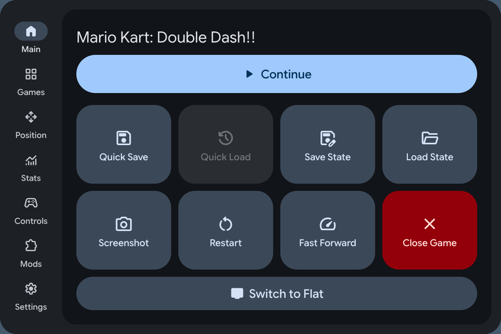
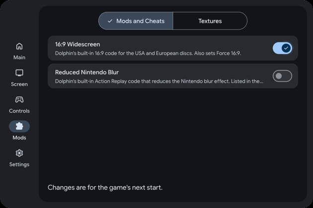

# Baiji VR

GameCube and Wii games in VR, running standalone on the Valve Steam Frame.
It is my unofficial fork of [Baiji](https://github.com/thejerf/baijiSteamVR), the Steam Frame version of [dolphinXR](https://github.com/iChris4/dolphinXR/), which is based on [Dolphin](https://dolphin-emu.org/).


This is my testing area for fixes and optimizations, and I plan to bring all of them upstream. You're welcome to use it. The new work is desktop-tested; testing on the Frame is in progress.

## Features

- Stereoscopic 3D on a big screen, or Immersive inside the game
- Switch between the two mid-game
- Natural 3D, matched to your IPD
- A redesigned VR menu with save states and autosave
- In-app mods, patches, cheats and texture packs
- Box art, a dark style, and windows that fit Game Mode
- Dynamic Resolution and other performance switches (experimental)

## 3D and immersion

- **Stereoscopic 3D or Immersive, any time**: press both bumpers, then **View** and **Menu**.
- **Immersive**: **World Scale** sets how big the game world feels.
- **Natural 3D**: at 100% **3D Depth**, distant scenery sits at essentially infinity.

## The VR menu

Hold **Menu** for 1 second to open the completely redesigned VR menu. Its **Mods** tab has:

- **Mods and Cheats**: 38 cheats, patches and game settings, and 3 mods, for 24 games
- **Textures**: 23 texture packs, from their creators' own pages

 

No texture pack is hosted by this project.

## Game-specific fixes

- **Fire Emblem: Path of Radiance**: the freeze and white screen. Desktop-tested; not confirmed on the Frame yet.
- **Games that change video modes**: the screen keeps one shape.
- **All VR games**: no crash on exit, and errors show in the headset.

## Experimental

All are off by default, in the **VR** settings under **Advanced**.

- **Dynamic Resolution**: up to two steps over **Internal Resolution** while the GPU has room.
- **Pin Emulation Threads**, **Performance Hint** and [more](docs/SETTINGS.md#performance), with a [performance test](docs/USER_GUIDE.md#performance-test).

## Requirements

- A Steam Frame with Developer Mode, SSH and about 250 MB of free storage
- A Linux PC (x86-64) with Git, Podman and Flatpak, to build it
- Your own GameCube and Wii games, dumped from your own discs

## Install

This fork has no download yet; [upstream Baiji](https://github.com/thejerf/baijiSteamVR/releases) has one.

1. Set up the [SSH name `frame`](docs/USER_GUIDE.md#connect-to-the-frame) on your PC.

2. Get the repository, build it and install it:

   ```sh
   git clone --recurse-submodules https://github.com/simplysanatori/baijiSteamVR.git
   cd baijiSteamVR
   ./scripts/compile-cross-sdk.sh
   ./scripts/deploy-frame.sh frame
   ```

3. Add it to Steam:

   ```sh
   ssh frame "steamos-add-to-steam ./baiji/bin/baiji-vr"
   ```

4. Launch **baiji-vr** from your Steam library.

## First run

1. Add the folder with your games in the settings, under **Paths**.
2. Double-click a game to start it.

## Controls


| Steam Frame | What it does |
|---|---|
| Hold **Menu** for 1 second | VR menu |
| Hold **View** for 1.5 seconds | Stop the game |
| **View**, then right or left bumper | Quick Save or Quick Load (hold the left bumper) |
| **View**, then right trigger | Fast Forward on or off |
| Both bumpers, then **View** and **Menu** | Stereoscopic 3D or Immersive |
| Grip | Move the screen |

Full list: [docs/CONTROLS.md](docs/CONTROLS.md).

## Update

Quit the emulator, then run this in the `baijiSteamVR` folder.

```sh
git pull
git submodule update --init --recursive
./scripts/compile-cross-sdk.sh
./scripts/deploy-frame.sh frame
```

## Uninstall

Run this on the Frame. Add `--purge` to also delete your settings and saves. Your games are never touched.

```sh
~/baiji/bin/baiji-uninstall
```

Moving your saves to Dolphin: [user guide](docs/USER_GUIDE.md#uninstall).

## Troubleshooting

- The pointer is off in Stereoscopic 3D: recenter once.
- A game looks wrong in Immersive: switch to Stereoscopic 3D.
- Fire Emblem: Path of Radiance goes white: turn off **Enable Dual Core** for that game.

More: [docs/USER_GUIDE.md](docs/USER_GUIDE.md#troubleshooting).

## Reporting a problem

Turn on the detailed log, then play until the problem happens:

```sh
ssh frame "touch ~/.config/baiji/debug-logging"
```

The logs are in `~/.local/share/baiji/Logs`; check them before sharing. Please don't report this fork's problems to Dolphin or Baiji.

## Roadmap (planned)

- **Upstream**: bring all of the fixes and features here upstream.

## More

- [User guide](docs/USER_GUIDE.md)
- [Settings](docs/SETTINGS.md)
- [AGENTS.md](AGENTS.md): for developers and AI agents
- [Building from source](docs/build-runbook.md)
- [Changelog](docs/CHANGELOG.md)
- [Baiji's README](README.upstream.md)

## Support

If you want to support this app or my other Steam Frame ports, such as PrimedFrame, you can [buy me a coffee](https://ko-fi.com/sana748653).

## Credits

- [Dolphin](https://dolphin-emu.org/): the emulator
- [dolphinXR](https://github.com/iChris4/dolphinXR/) by iChris4: the VR modes, and some performance switches
- [Baiji](https://github.com/thejerf/baijiSteamVR) by thejerf: the Steam Frame version
- [Azahar for Frame](https://github.com/simplysanatori/AzaharVR), my Azahar fork: the VR menu, Dynamic Resolution, window fitting and downloads
- [GameTDB](https://www.gametdb.com/) and [libretro-thumbnails](https://github.com/libretro-thumbnails): box art
- Mods, cheats and texture packs: their authors, named in the app
- Valve: SteamVR and the Frame

Full list: [Externals/licenses.md](Externals/licenses.md). Not affiliated with Nintendo, Valve or the Dolphin project.

## Licence

GPLv3 or any later version. Dolphin's own files are GPLv2 or later. See [COPYING](COPYING) and [LICENSES](LICENSES).

## How this was made

I started this project and used AI (Claude) to speed up development. I write, review and fix code by hand all the way through, keep the AI's work checked and reined in, and aim to keep the port as lightweight as possible. I test it on my own Steam Frame.
