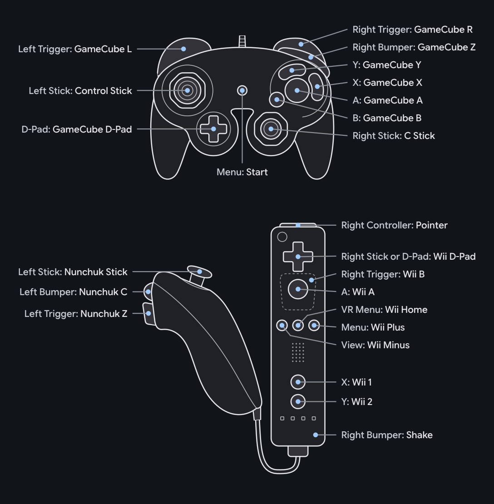

# Controls

## In every game

| Steam Frame | What it does | Notes |
|---|---|---|
| **Menu**, held for 1 second | VR menu | A short press is the game's button |
| **View**, held for 1.5 seconds | Stop the game | Also in the VR menu. A short press is the game's button |
| **View**, then right bumper | Quick Save | When you let go of the bumper |
| **View**, then left bumper held for half a second | Quick Load | |
| **View**, then right trigger | Fast Forward on or off | When you let go of the trigger |
| Both bumpers, then **View** and **Menu** | Stereoscopic 3D or Immersive | |
| Right stick click, held for 1 second | Reset the screen or view | |
| Grip | Move the screen | **Lock Screen** turns it off |
| Grip and stick | Screen distance and size | |
| Grip and D-Pad left or right | Nudge the screen | |
| Grip and D-Pad up or down | **Screen Curve**, a step at a time | Stereoscopic 3D |

While a grip holds the screen, a hint under it shows these.

In Flat, **Menu** held for 3 seconds asks **Switch to VR?**: **A** is Yes, **B** is No. The game gets **Menu**, too.

## The Window in Game Mode

| Control | In the game list | In a dialog |
|---|---|---|
| Left stick or D-Pad | Moves | Moves |
| **A** | Twice starts the game | Presses |
| **B** | Back | Back |
| Right stick | Scrolls | Scrolls |
| Bumpers | | Between items |

## The VR Menu

Point at it with either controller. The trigger or **A** chooses, **B** goes back, **Menu** closes it. A stick scrolls a list. Point at a row for a moment and it says what it does, or why it is greyed.

| Tab | What is on it |
|---|---|
| **Main** | **Continue**, **Quick Save**, **Quick Load**, **Save State**, **Load State**, **Screenshot**, **Restart**, **Fast Forward** (**Wii Home** in a Wii game), **Close Game**, **Switch to Flat** |
| **Games** | The games of the window's list. A press starts one, after a question; the three dots have more |
| **Position** | **Reset Screen** or **Reset View**, **Display**, **Distance**, **Size**, **Screen Curve**, **Aspect Ratio**, **Lock Screen**, **2D Parts on a Screen** |
| **Stats** | **Show Stats**, **Stats Position** and the numbers of the last second |
| **Controls** | The game's controller with what is on each control, **Edit Controls**, and **Shortcuts** with the table above |
| **Mods** | **Mods and Cheats** and **Textures** for the game |
| **Settings** | **General**, **Graphics** and **Immersive** |

The game is paused behind the menu. On **Position**, and on **Graphics** and **Immersive** of **Settings**, it runs, so a change shows at once.

**Global** and **Per-Game** at the top right say whose settings the page shows and changes: every game's, or only this game's. A game's own value is in front of the global one. The three dots have **Use Global Values for All**, which removes this game's values on that page.

### Games

The chips show all games, **GameCube** or **Wii**; **Sort** changes their order. The right stick scrolls. Choosing a game asks before the running one closes; the running game's tile goes back to it. The three dots of a tile, or **X** with the D-Pad, have **Play**, **Favourite** and the covers.

### Stats

**Show Stats** keeps the numbers in view while you play. **Stats Position** is **In Front** or **On Wrist**.

| | |
|---|---|
| **In Front** | A window in the room, in front of the screen. A grip on it moves it, and that hand's stick sets its distance and size. Resetting the screen or view puts it back |
| **On Wrist** | On the left controller. It shows while the back of that hand faces you |

**Internal Resolution** is the one in use. With **Dynamic Resolution** on, the row is lit for a few seconds when it changes, and **Last Change** says from what to what, and how long ago.

## Face Buttons

They are by position, as on Nintendo's controllers.

| Steam Frame | GameCube | Wii Remote | Wii Remote (Sideways) | Classic Controller |
|---|---|---|---|---|
| **A** (bottom) | B | B | 2 | B |
| **B** (right) | A | A | A | A |
| **X** (left) | Y | 2 | 1 | Y |
| **Y** (top) | X | 1 | B | X |

The right trigger is the Wii Remote's B, too, and the right bumper shakes it. The Classic Controller's L and R are the triggers, ZL and ZR the bumpers, **View** is − and **Menu** is +.

## Wii Games

The **Controls** tab has a chip for each controller of a Wii game: **GameCube** (GameCube Controller), **Wii Remote**, **+ Nunchuk** (Wii Remote + Nunchuk), **Sideways** (Wii Remote (Sideways)) and **Classic** (Classic Controller). The choice is for this game only and can be changed while it runs. The drawing follows it.

| | |
|---|---|
| Without a choice | The Wii Remote of the Controllers settings: Wii Remote + Nunchuk at first. |
| Well-known games | Start with their own, and a notice says which: Wii Remote (Sideways) in *Kirby's Return to Dream Land* and *New Super Mario Bros. Wii*, for example. The list is `Data/Sys/WiiControllers.ini`. Your choice is in front of it. |
| A game's own settings | A profile, the first port or the Wii Remote's source in its INI is in front of the list. A profile is in front of your choice, too. |
| Another extension | Chosen in the mapping window (Guitar, for example): no chip is filled, and the game keeps it until you choose a chip. |

With the Wii Remote on its side, rolling the right controller tilts it, as turning a wheel.

## Editing the Controls

**Edit Controls** on the **Controls** tab shows the game's controller with a chip on every button and stick.

| | |
|---|---|
| A chip | Listens for 6 seconds: **Press a Button…** shows. Press the Frame button for it. |
| A stick's chip | **Push the Stick Up…**, then **Push the Stick Right…**. |
| **Cancel** | Stops listening. |
| **Reset to Default** | The Steam Frame layout of this controller. |
| **Profile** | The saved profile this game uses, or **Default**: the mapping of every game. It lists the mapping window's profiles of this controller. |

**Global** and **Per-Game** at the top of the **Controls** tab:

| | |
|---|---|
| **Global** | The mapping of this controller in every game. |
| **Per-Game** | This game gets its own profile, a copy of the mapping it has. **Use Global Values** (the three dots) removes it. A profile you chose from the list stays saved. |

Each controller has its own mapping: GameCube Controller, Wii Remote, Wii Remote + Nunchuk, Wii Remote (Sideways) and Classic Controller. A game's profile belongs to one of them: with another chip it is set aside, and that controller's chip brings it back. The mapping window in the Controllers settings shows the mapping the game has, and its title says which.

| Mapping | File in `Config/` |
|---|---|
| Every game | `GCPadNew.ini`, `WiimoteNew.ini` |
| A Wii Remote that `WiimoteNew.ini` is not for | `Profiles/Wiimote/VR <controller>.ini` |
| One game, with **Per-Game** | `Profiles/GCPad/<game ID> GameCube Controller.ini`, `Profiles/Wiimote/<game ID> <controller>.ini` |
| One game, with another profile | That profile in `Profiles/GCPad/` or `Profiles/Wiimote/` |

Which profile a game has is in its `GameSettings/<game ID>.ini`, as in Dolphin: `PadProfile1` and `WiimoteProfile1` under `[Controls]`. Its controller is `WiiController` under `[Graphics.VR]`.

The Wii Remote's extension can be chosen in the Controllers settings without opening the mapping window. During a Wii game, that changes the game's controller.
